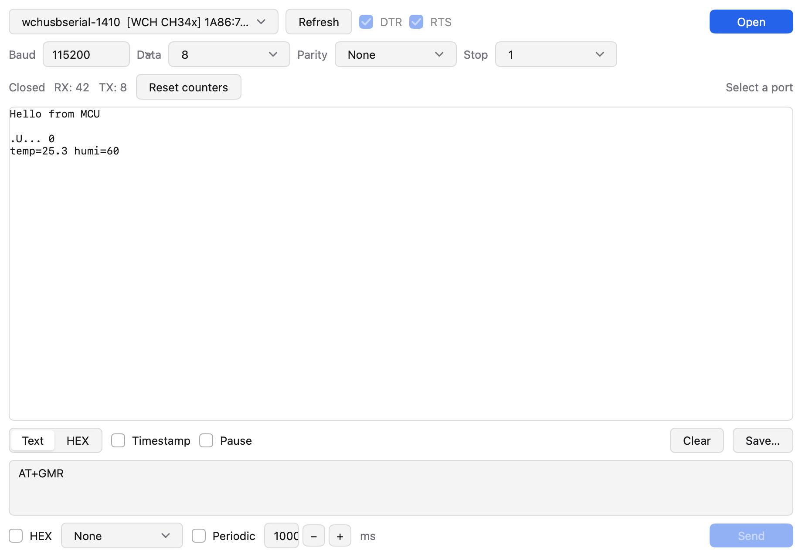

# SerialComm

A serial port tool for macOS in the spirit of SSCOM — written in pure Go
with [MyGo](https://github.com/egoist/mygo) native UI (GPU-rendered, no
webview, no cgo) and [go.bug.st/serial](https://go.bug.st/serial).



## Features

- **Port enumeration** — lists `/dev/cu.*` devices with chipset detection
  (WCH CH34x incl. CH347, FTDI, Silicon Labs CP210x, Prolific PL2303,
  CDC-ACM, Espressif, STM32…) and USB VID:PID resolved through IOKit;
  the list refreshes itself on plug/unplug
- **Full port configuration** — baud rate (editable, incl. non-standard
  rates), data bits 5–8, parity None/Odd/Even/Mark/Space, stop bits
  1/1.5/2 — re-applied live while the port is open
- **Receive** — Text/HEX display, per-chunk timestamps, pause, clear,
  save to file, RX/TX byte counters, auto-scroll to newest data
- **Send** — text or HEX input, line-ending suffix (None/\r/\n/\r\n/\n\r),
  periodic send with a configurable interval
- **Modem lines** — DTR/RTS toggles (handy for resetting MCUs into
  download mode)
- **Responsiveness** — all blocking work (subprocesses, serial I/O) stays
  off the UI thread; UTF-8 safe text view (CJK text is not mangled)

## Requirements

- Go 1.27.3+ (older toolchains fetch it automatically via `toolchain`)
- macOS (Linux/Windows should work but are untested)

## Run

```sh
go run .            # build and run
go tool mygo dev    # develop with live reload
```

## Test

```sh
CGO_ENABLED=0 go test ./...
go tool mygo vet .
```

## Package

```sh
go tool mygo build  # -> build/darwin-arm64/SerialComm.app + .dmg
```

## Layout

| File            | Contents                                                        |
| --------------- | --------------------------------------------------------------- |
| `main.go`       | app state, view, port read/send goroutines                       |
| `serial.go`     | port enumeration (chip detection, ioreg VID/PID), mode parsing   |
| `format.go`     | hex dump/parse, UTF-8 safe display sanitizing                    |
| `main_test.go`  | unit + view tests (`ui.NewTester`)                               |
| `render_test.go`| renders the view to `/tmp/serialcomm_render.png`                |

---

# SerialComm（中文）

一款 macOS 上的 SSCOM 风格串口调试工具，纯 Go 编写 —— UI 用
[MyGo](https://github.com/egoist/mygo) 原生渲染（无 webview、无 cgo），
串口层用 [go.bug.st/serial](https://go.bug.st/serial)。

## 功能

- **串口枚举**：列出 `/dev/cu.*` 设备，识别芯片（WCH CH34x 含 CH347、
  FTDI、CP210x、PL2303、CDC-ACM、ESP32、STM32 等），经 IOKit 解析
  USB VID:PID；插拔自动刷新列表
- **串口配置**：波特率（可手输任意值）、数据位 5–8、校验位
  None/Odd/Even/Mark/Space、停止位 1/1.5/2；打开状态下可实时改参数
- **接收**：文本/HEX 显示、时间戳、暂停、清空、保存到文件、RX/TX
  字节计数、自动滚动到最新数据；UTF-8 安全（中文不乱码）
- **发送**：文本或 HEX 输入、行尾追加（None/\r/\n/\r\n/\n\r）、
  可配置间隔的定时发送
- **信号线**：DTR/RTS 控制（可用于复位 MCU 进下载模式）
- **流畅性**：所有阻塞操作（子进程、串口 I/O）都不在 UI 线程

## 运行

```sh
go run .            # 编译运行
go tool mygo dev    # 开发模式（热重载）
go tool mygo build  # 打包 .app + .dmg
```

## License

[MIT](LICENSE)
