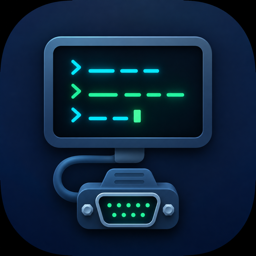
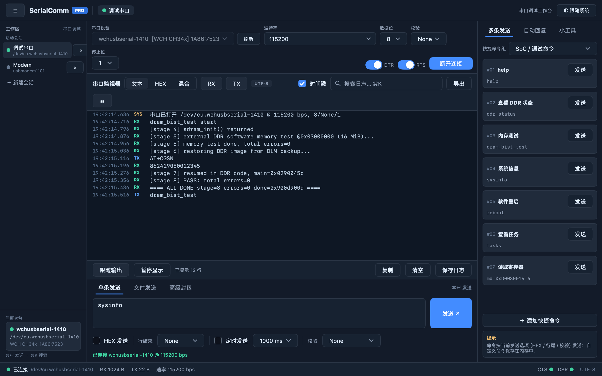
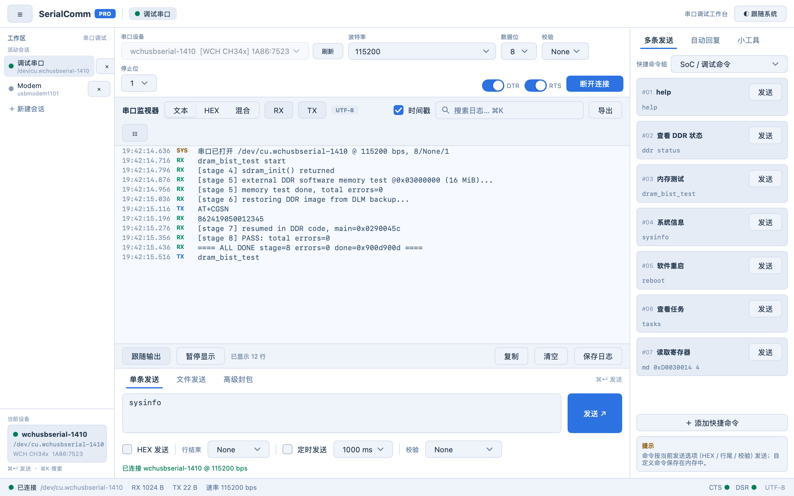

# SerialComm



[](https://github.com/xixijay1988/SerialComm/actions/workflows/ci.yml)

A serial port debugging tool for macOS in the spirit of SSCOM — written
in pure Go with [MyGo](https://github.com/egoist/mygo) native UI
(GPU-rendered, no webview, no cgo) and
[go.bug.st/serial](https://go.bug.st/serial).



<details><summary>Light theme</summary>



</details>

## Features

- **Workspace sessions** — multiple independent sessions, each with its
  own port, configuration, log, counters and send settings; create,
  switch and close from the sidebar
- **Port enumeration** — lists `/dev/cu.*` devices with chipset
  detection (WCH CH34x incl. CH347, FTDI, CP210x, PL2303, CDC-ACM,
  Espressif, STM32…) and USB VID:PID resolved through IOKit; the list
  refreshes itself on plug/unplug
- **Full port configuration** — baud rate (editable, incl. non-standard
  rates), data bits 5–8, parity None/Odd/Even/Mark/Space, stop bits
  1/1.5/2 — re-applied live while the port is open
- **Console** — Text/HEX/mixed display, RX/TX/SYS tags, per-line
  timestamps, RX/TX filters, search (⌘K), pause, follow-tail,
  selectable and copyable log text, copy/clear/save; stale driver
  buffer is flushed on connect so the log starts at the live stream
- **Send** — text or HEX input, line-ending suffix (None/CR/LF/CRLF),
  periodic send with a configurable interval, appended checksum
  (CRC16-Modbus, CRC16-CCITT, SUM8, XOR8), ⌘↵ to send
- **Quick commands** — preset command groups (SoC debug, AT, Modbus
  RTU) plus user-defined commands, one click to send
- **Modem lines** — DTR/RTS toggles (handy for resetting MCUs into
  download mode), CTS/DSR indicators in the status bar
- **Appearance** — follows the macOS system appearance, or pin light /
  dark manually
- **Responsiveness** — all blocking work (subprocesses, serial I/O)
  stays off the UI thread; UTF-8 safe text view (CJK is not mangled)

## Install

Download the DMG from
[Releases](https://github.com/xixijay1988/SerialComm/releases)
(macOS, Apple Silicon). The app is ad-hoc signed — if Gatekeeper blocks
it, right-click → Open, or run
`xattr -dr com.apple.quarantine SerialComm.app`.

## Requirements

- Go 1.27+ (older toolchains fetch it automatically via `toolchain`)
- macOS (Linux/Windows should work but are untested)

## Run

```sh
go run .            # build and run
go tool mygo dev    # develop with live reload
```

## Test

```sh
go test ./...        # unit + view + fuzz-seed tests
go test -race ./...  # race detector
go vet ./...
go tool mygo vet .   # MyGo lifetime/threading checks
go test -fuzz=FuzzParseHex -fuzztime=10s .  # fuzz the hex parser
```

## Package

```sh
go tool mygo build  # -> build/darwin-arm64/SerialComm.app + .dmg
```

Tagging `vX.Y.Z` and pushing runs the release workflow: tests, builds
the DMG and publishes it to GitHub Releases.

## Layout

| File               | Contents                                                        |
| ------------------ | --------------------------------------------------------------- |
| `main.go`          | app/session state, connect, read/send loops, record assembly     |
| `view.go`          | the whole UI: sidebar, console, send area, status bar            |
| `serial.go`        | port enumeration (chip detection, ioreg VID/PID), mode parsing   |
| `format.go`        | hex dump/parse, UTF-8 safe display sanitizing                    |
| `checksum.go`      | CRC16-Modbus/CCITT, SUM8, XOR8                                   |
| `commands.go`      | quick-command groups                                            |
| `theme.go`         | light/dark palettes                                             |
| `*_test.go`        | per-file tests + fuzz + property tests + render screenshots      |

---

# SerialComm（中文）

一款 macOS 上的 SSCOM 风格串口调试工具，纯 Go 编写 —— UI 用
[MyGo](https://github.com/egoist/mygo) 原生渲染（无 webview、无 cgo），
串口层用 [go.bug.st/serial](https://go.bug.st/serial)。

## 功能

- **多会话工作区**：每个会话独立持有串口、参数、日志、计数和发送
  设置；侧栏可新建/切换/关闭
- **串口枚举**：列出 `/dev/cu.*` 设备，识别芯片（WCH CH34x 含 CH347、
  FTDI、CP210x、PL2303、CDC-ACM、ESP32、STM32 等），经 IOKit 解析
  USB VID:PID；插拔自动刷新
- **串口配置**：波特率（可手输任意值）、数据位 5–8、校验位
  None/Odd/Even/Mark/Space、停止位 1/1.5/2；连接中可实时改参数
- **控制台**：文本/HEX/混合显示、RX/TX/SYS 彩色标签、逐行时间戳、
  RX/TX 过滤、搜索（⌘K）、暂停、跟随输出、日志可框选复制、
  复制/清空/保存；连接时自动清空驱动旧缓存，只显示实时数据
- **发送**：文本或 HEX、行尾追加（None/CR/LF/CRLF）、可配置间隔的
  定时发送、附加校验（CRC16-Modbus、CRC16-CCITT、SUM8、XOR8）、
  ⌘↵ 快捷发送
- **快捷命令**：内置命令组（SoC 调试、AT、Modbus RTU）+ 自定义命令，
  一键发送
- **信号线**：DTR/RTS 控制（可复位 MCU 进下载模式），状态栏显示
  CTS/DSR
- **外观**：默认跟随 macOS 系统浅色/深色，也可手动固定
- **流畅性**：所有阻塞操作（子进程、串口 I/O）都不在 UI 线程；
  UTF-8 安全（中文不乱码）

## 安装

从 [Releases](https://github.com/xixijay1988/SerialComm/releases)
下载 DMG（macOS，Apple Silicon）。应用为 ad-hoc 签名，首次打开如被
Gatekeeper 拦截：右键 → 打开，或
`xattr -dr com.apple.quarantine SerialComm.app`。

## 运行

```sh
go run .            # 编译运行
go tool mygo dev    # 开发模式（热重载）
go test ./...       # 单元测试 + 视图测试 + fuzz 语料
go tool mygo build  # 打包 .app + .dmg
```

## License

[MIT](LICENSE)
